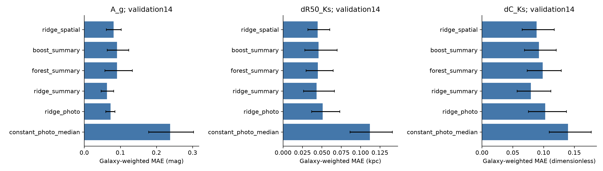
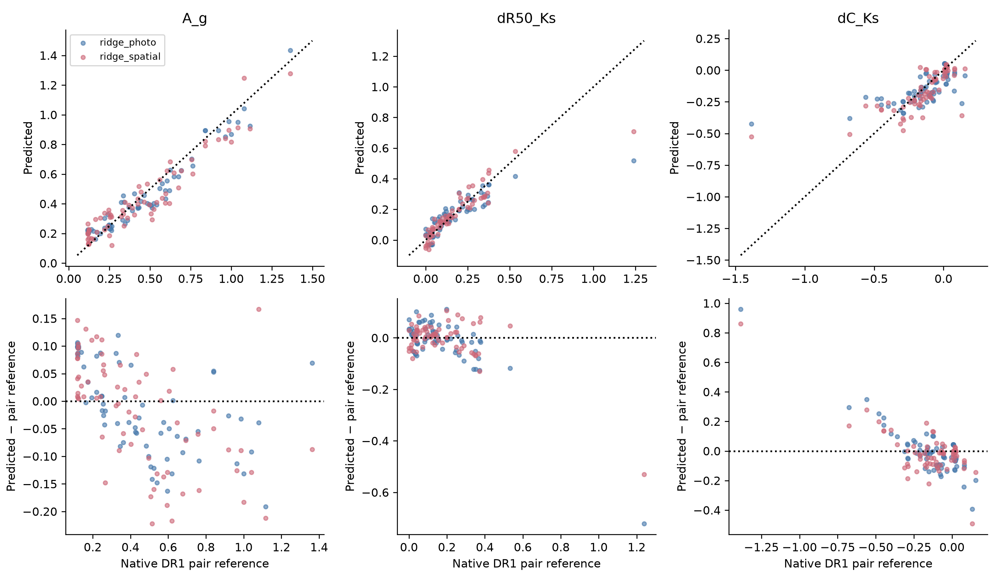
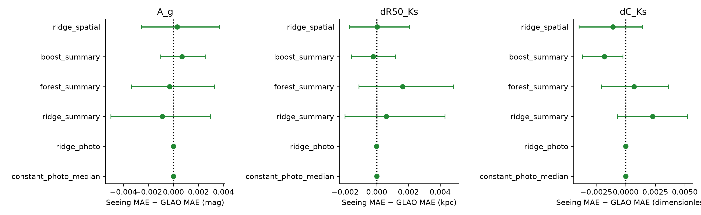
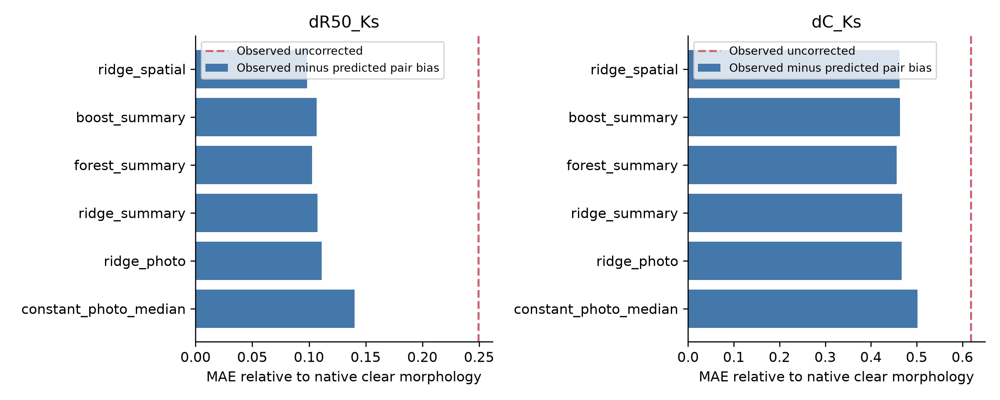
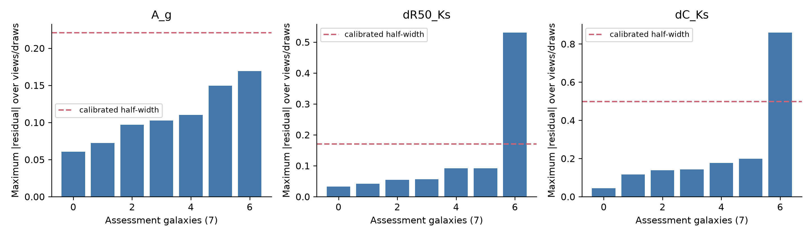
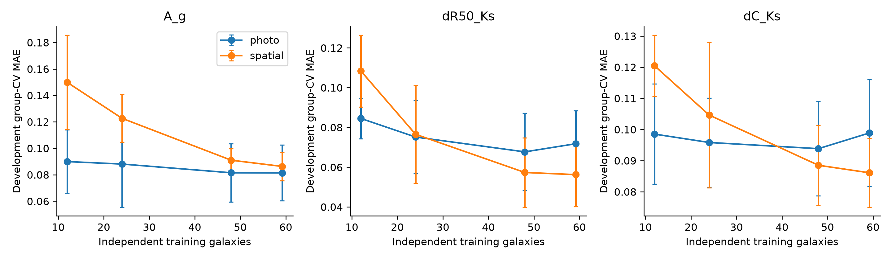
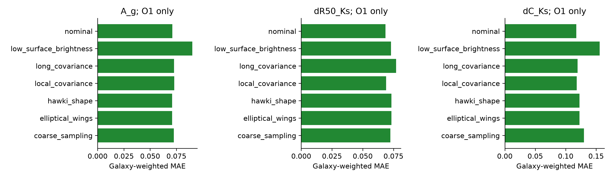

# Supplementary grouped validation: ULTIMATE–Subaru ML feasibility

Executed continuation, 2026-10-28, existing phd environment. Earlier analyses are preserved. Scope: useful attenuation statistics and morphology-bias prediction from conditional optical/NIR mocks, with explicit failure cases.

## Scientific decision

The expanded experiment tests prediction of **signed DR1 dusty/clear paired-image differences**. It does not resolve their physical calibration: zero-projected-dust galaxies retain systematic spectral and spatial residuals. Model MAE cannot be interpreted as equivalent physical dust precision. A paper on a carefully qualified benchmark is feasible; a validated observer-frame ULTIMATE dust-geometry forecast or unique three-dimensional reconstruction is not established.

- **A_g:** best numerical MAE 0.06274 (ridge_summary); photometric ridge 0.07273; median constant 0.23784. The best row is descriptive across the recorded models, not a new test-driven model selection.
- **dR50_Ks:** best numerical MAE 0.04335 (ridge_summary); photometric ridge 0.05112; median constant 0.11218. The best row is descriptive across the recorded models, not a new test-driven model selection.
- **dC_Ks:** best numerical MAE 0.07939 (ridge_summary); photometric ridge 0.10259; median constant 0.13963. The best row is descriptive across the recorded models, not a new test-driven model selection.

The pre-existing pipeline completed the project’s single frozen final evaluation in ../ml_expanded_20261028/. These supplementary models remain validation-only and were never evaluated on the final galaxies. Consult project_continuation_report.md for the verified canonical final results; no second final scoring is performed here.

## Sample and provenance

All 120 archives are present. Independently recomputed compressed SHA256 and byte lengths match the downloader's CRC/tar-validated records; no duplicate download was started. Frozen assignments remain 86 development, 14 validation, 20 final. Nonfinal audit independently checks 500 views/3500 cache arrays and 24000 FITS headers; 6240 original26 member hashes match previous inventories. Units: MJy/sr for images, Msun/pc² for projected dust. Band identity is supplied by archive basenames because the analytic FITS headers have no filter keyword; names alone do not prove historical filter-response equivalence. g/J/Ks and dust full arrays are validated; other bands have header/member-hash checks. Failed source preparations:0.

Nonfinal zero-field controls: 13, including the original four. All remain in their frozen galaxy partition; source-null status excludes development controls from fits, never reassigns them to the final set. No SFR-based dust-free classification is used.

| partition | zero_projected_dust | galaxies |
| --- | --- | --- |
| development | False | 74 |
| development | True | 12 |
| validation | False | 13 |
| validation | True | 1 |

Equal-galaxy metrics describe this deliberately selected mass/activity sample. They are not volume-weighted population estimates. Five views include antipodal directions; neither views nor noise draws are independent galaxies. Physical stellar mass, SFR and dust are diagnostic columns only, absent from predictor allowlists.

## Target reliability and aperture definition

A_g=−2.5log10(sum dusty/sum clear). ΔR50 and ΔC are native dusty minus clear within the same aperture; C=5log10(R80/R20), first signed cumulative-flux crossings. Smoothed spatial median/IQR use1-kpc Gaussian FWHM, positive finite pixels and clear>1e−4 of peak; valid negative attenuation remains. These are area-weighted effective statistics, not dust mass, optical depth or unique 3D geometry.

Fixed12 is a circular R<12kpc aperture at the known origin. Adaptive R=clip(1.5 R80 measured within R35 in the deep dusty-Ks seeing reference,8,30)kpc. This reduces some truncation but uses a finite reference and idealized deep Ks segmentation. It is not a validated total-light aperture, especially when capped; flags retain capped/minimum-limited and <90% R35-flux cases. Because adaptive selection uses NIR, the strict optical-only information comparison uses fixed12 as primary. Alternative aperture results change the estimand rather than supplying random label-error draws.

| target | median_galaxy_absolute_change | mean_galaxy_absolute_change | max_galaxy_absolute_change |
| --- | --- | --- | --- |
| A_g | 0.02171 | 0.03065 | 0.17263 |
| dR50_Ks | 0.01868 | 0.04152 | 0.33010 |
| dC_Ks | 0.03108 | 0.03906 | 0.17876 |
| A_Ks | 0.00347 | 0.00601 | 0.03944 |
| A_g_p50_1kpc | 0.02275 | 0.05646 | 0.43245 |
| A_g_IQR_1kpc | 0.02933 | 0.06258 | 0.64295 |

Old-four matched-operator control envelopes, defined from the original controls only; the integrated-Ks extension follows the same policy before final freezing:

| aperture | target | max_abs |
| --- | --- | --- |
| adaptive | A_g | 0.12433 |
| adaptive | dR50_Ks | 0.03749 |
| adaptive | dC_Ks | 0.23982 |
| adaptive | A_g_p50_1kpc | 0.11907 |
| adaptive | A_g_IQR_1kpc | 0.01211 |
| fixed12 | A_g | 0.12392 |
| fixed12 | dR50_Ks | 0.03918 |
| fixed12 | dC_Ks | 0.04596 |
| fixed12 | A_g_p50_1kpc | 0.11887 |
| fixed12 | A_g_IQR_1kpc | 0.01446 |
| adaptive | A_Ks | 0.02259 |
| fixed12 | A_Ks | 0.02159 |

No envelope is subtracted, treated as sigma, or used to force targets to zero. The large adaptive concentration residual is retained. Direct raw/cache matches and common units/WCS disfavor local processing as the primary integrated-offset cause. Full160-kpc g control offsets persist near0.121mag, with alternating signs across filters. Smoothing reduces normalized spatial residuals, compatible with a Monte Carlo contribution; it cannot explain the coherent integrated band pattern alone. Different analytic-probe versus Monte Carlo spectral/filter operators are a leading candidate, not a demonstrated historical configuration error. Source-owner NoMedium runs with frozen particle SEDs/filters, convolve=false/true and repeated photon seeds are required to settle this. See the existing source audit in `../ml_expanded_20261028/label_audit/source_label_report.md`.

## Training and Validation 14 predictions

Only observed dusty-image fluxes, colours, radii, concentration, q, asymmetry, radial fractions, colour gradients, angular harmonics, texture and normalized8×8 cells enter X. Metadata, clear images, target columns, true dust/stellar maps and galaxy IDs never enter X. Constant median/mean, photometric ridge, summary ridge, random forest, gradient boosting and spatial ridge are all retained. A photometric regression is a simple empirical colour/luminosity baseline; the fixed-distance luminosity prior limits transfer.

Five-fold galaxy-grouped development CV chooses settings. Median imputation and scaling fit inside each fold. Ridge alpha1/10/100/1000; forest120trees with leaf8/24 and max_features0.75; boosting100depth2trees, learning_rate0.04, Huber loss, leaf12/32. Validation never selects hyperparameters. The development tuning scores are not unbiased out-of-sample performance. Independent validation/final metrics average absolute/squared error within galaxy, then equally across galaxies. RMSE=sqrt(mean galaxy MSE). MAE95% intervals resample galaxies conditional on the fitted models; they do not include retraining or unknown source-product systematics.

Validation 14 fixed12, nominal seeing g/J/Ks MAE (mag for attenuation, kpc for ΔR50, dimensionless ΔC):

| target | constant_photo_median | constant_photo_mean | ridge_photo | ridge_summary | forest_summary | boost_summary | ridge_spatial |
| --- | --- | --- | --- | --- | --- | --- | --- |
| A_g | 0.23784 | 0.24598 | 0.07273 | 0.06274 | 0.09074 | 0.09065 | 0.08124 |
| dR50_Ks | 0.11218 | 0.11824 | 0.05112 | 0.04335 | 0.04489 | 0.04579 | 0.04455 |
| dC_Ks | 0.13963 | 0.14641 | 0.10259 | 0.07939 | 0.09867 | 0.09261 | 0.08889 |
| A_Ks | 0.04610 | 0.05196 | 0.01488 | 0.01463 | 0.01363 | 0.01410 | 0.01689 |
| A_g_p50_1kpc | 0.06615 | 0.09034 | 0.07382 | 0.05991 | 0.05343 | 0.04742 | 0.06071 |
| A_g_IQR_1kpc | 0.11806 | 0.13976 | 0.10689 | 0.06938 | 0.06212 | 0.06201 | 0.08315 |

The median-attenuation and IQR targets remain exploratory, with every unsuccessful model in the table. An improvement would concern an effective projected statistic; it does not uniquely identify geometry. Full per-view/draw predictions, signed residuals, MAE/RMSE/bias and empirical baseline comparisons are saved.

## Does GLAO add information?

The comparison fixes galaxies, bands, sampling and1h per band. Optical g stays0.700arcsec in both modes. Nominal Gaussian J widths0.658/0.508arcsec and Ks0.588/0.390arcsec are inherited provisional scenarios; this is not a new claim of a measured0.2arcsec ULTIMATE PSF. Optical-only g versus g/J/Ks separates extra bands from seeing/GLAO resolution, but1versus3hours total is an information ablation, not equal-total-time efficiency.

Validation 14 seeing MAE minus GLAO MAE, positive denotes improvement:

| target | model | gain | lo | hi |
| --- | --- | --- | --- | --- |
| A_g | ridge_photo | -0.00001 | -0.00004 | 0.00004 |
| A_g | ridge_summary | -0.00089 | -0.00500 | 0.00296 |
| A_g | ridge_spatial | 0.00030 | -0.00255 | 0.00367 |
| dR50_Ks | ridge_photo | -0.00001 | -0.00003 | 0.00001 |
| dR50_Ks | ridge_summary | 0.00061 | -0.00200 | 0.00429 |
| dR50_Ks | ridge_spatial | 0.00004 | -0.00172 | 0.00206 |
| dC_Ks | ridge_photo | -0.00001 | -0.00002 | 0.00001 |
| dC_Ks | ridge_summary | 0.00228 | -0.00070 | 0.00523 |
| dC_Ks | ridge_spatial | -0.00108 | -0.00395 | 0.00142 |

Among these nine prelisted ridge/primary-target comparisons, 0 intervals are wholly positive, 0 wholly negative and 9 cross zero. These are marginal conditional intervals across a larger family of comparisons, with no multiplicity-adjusted detection claim. A robust physical-inference benefit cannot be inferred from a single favorable cell. `paired_galaxy_comparisons.csv` separately records the extra-NIR-band contribution on validation14. Equal-noise/noiseless scoring uses nominal-trained frozen models and therefore diagnoses sensitivity; it does not claim matched-condition retraining.

A smaller PSF can preserve dusty morphology while failing to improve prediction of a subtle paired dust difference. Compression, finite independent sample size, source-label residuals and population–dust degeneracy remain competing limits. Earlier full-pixel known-pair separation showed that aperture compression can discard information; the present8×8-cell ridge experiment is a bounded spatial-feature test, not a validated full-image generative inference.

## Morphology correction

`morphology_correction_accuracy.csv` compares observed dusty morphology before/after subtracting the predicted native pair bias with the native clear reference. A separate native correction isolates pair-bias prediction from PSF/noise effects. Predicting the pair bias well does not automatically eliminate the PSF contribution. Constant and photometric corrections remain explicit comparators, including adverse galaxies and viewing directions.

## Calibration, OOD and learning curves

Seven validation galaxies calibrate each80% simultaneous galaxy interval via maximum absolute residual across all views/draws; seven different validation galaxies assess coverage. With seven calibrators rankceil(8×0.8)=7 uses the maximum; widths may be broad. The validation selection, small counts and source-label systematics preclude an unqualified population coverage guarantee. `uncertainty_calibration.csv` retains entire-galaxy and row coverage separately. If final scores exist, final 20 assess the same frozen widths independently.

The deliberate OOD challenge holds out the development upper stellar-mass quartile and retunes on lower-mass training galaxies only. It is a same-simulation covariate shift, not simulation-to-real validation. `OOD_summary.csv` and per-orientation predictions retain failures. Source-null predictions remain a separate challenge. Mass/SFR/dust, apparent q, flux and view diagnostics are saved; apparent q is not known physical inclination and fixed directions are not an isotropic population.

Development learning curves use12/24/48/all available training galaxies per outer fold, with tuning repeated within each subset. Fold scatter is descriptive, not an independent-galaxy confidence interval. These curves assess whether model variance still changes with sample size; they cannot establish that more same-source data remove systematic label or simulation-domain error.

## Empirical HAWK-I-informed sensitivity

Existing ESO reduced NGC3256 products supply PSF/noise information only. Candidate median FWHM0.3166arcsec differs from the nine quality-selected2MASS associations'0.2935arcsec; beta and q are selection-dependent. Sensitivity uses beta3.7415/q0.8199 for elliptical NIR wings at nominal D50; a separately named HAWK-I-shape condition uses actual0.2935arcsec Ks FWHM in the assisted branch. Optical g remains unchanged. This is not evidence for a real0.2arcsec ULTIMATE PSF.

O1/two-draw sensitivity includes nominal, local covariance, an explicit added long-scale component, wings, HAWK-I shape,0.2arcsec sampling and quarter surface brightness. Coarser pixels scale sky variance by pixel area while retaining per-pixel read/dark terms. Local covariance reproduces adjacent rho≈0.28–0.29, but gives R32 aperture excess≈1.59 rather than measured3.42; the long-component stress gives≈2.72 and is deliberately not described as a calibrated ESO covariance model. No ADU noise amplitude is transplanted into simulation electrons. Field PSF variation, anisotropic sky, real masks/centering and full covariance remain unvalidated.

Frozen models score these inputs without retuning. O1 sensitivity is not the full-five-view primary benchmark. `sensitivity_summary.csv` retains all outcomes; `hawki_collaborator_manifest.md` and two small CSV manifests list relevant existing reduced products/calibration references without packaging or transfer. The collaborator's independent raw reduction is not duplicated. HAWK-I supplies neither dust truth nor independent validation of ML attenuation.

## Literature and publication assessment

[Fu et al.2025](https://academic.oup.com/mnras/article/540/3/2081/8140852) provides a direct image-based attenuation-ML precedent using high-redshift IllustrisTNG/JWST mocks and CNNs. Its epoch, bands and parametrized dust targets differ from these low-redshift paired morphology labels; agreement with an SED-fitting estimator is model-dependent. Our added value must be controlled instrumental information tests, interpretable baselines and grouped generalization, rather than the first use of ML for attenuation.

The closest verified Dobbels reference is [Dobbels & Baes2021, A&A655A34](https://arxiv.org/abs/2110.01704), which predicts resolved dust luminosity/mass/temperature maps from UV–MIR images. The requested “Dobbels et al.2022” was not uniquely identified and is not silently relabelled. Their galaxy-to-galaxy bias motivates group-held-out tests; emission/SED-derived targets are distinct from paired attenuation truth.

[Bokona Tulu et al.2026](https://arxiv.org/abs/2605.20886) already studies wavelength and dust dependence of nonparametric morphology in the1154-galaxy TSA. Their StatMorph operator differs from ours. Rediscovering dust-dependent morphology is insufficient novelty. [DeepMerge II](https://arxiv.org/abs/2103.01373) shows that simulation/observation domain shifts can degrade astronomical ML and that domain adaptation can help classification; this does not validate calibration of a continuous dust target here.

A publishable contribution is a transparent **conditional surrogate benchmark** establishing which effective pair statistics beat empirical baselines, which corrections survive aperture/systematic tests and whether NIR resolution contributes beyond photometry. Required before a physical ULTIMATE forecast: historical source/filter operator reconciliation; packet uncertainty/convergence; observer-frame spectral/instrument synthesis; independent stellar-population prescriptions and cross-simulation tests; calibrated field-dependent PSFs, sky/covariance, depth and segmentation; external attenuation constraints with their own model uncertainty. Large CNN/U-Net training would not remove these prerequisites.

The earlier98.4% screen false-positive failure, failed forward-model predictive adequacy, unsuccessful spatial median and weak GLAO results remain evidence. This continuation does not replace them with an unsupported3D-geometry success claim.
